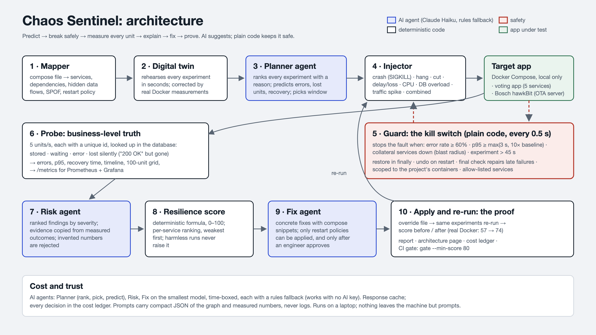
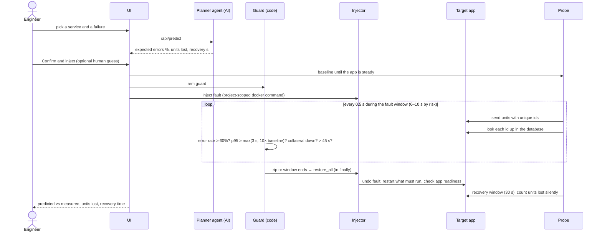

# Chaos Sentinel: architecture and workflow

Team No-15 "Lil bosch". This page describes how the system is built, how one experiment flows through it, and where each
Bosch requirement (Milestone 1, Milestone 2, optional) is met, with the file or screen that proves it.



## 1. What it does, in one line
An AI chaos-engineering tool for any Docker Compose app: it **maps** the app, **predicts** the damage, **injects** a fault
behind a deterministic kill switch, **measures** every unit of work by id, **restores**, **explains**, proposes a **fix**, and
**re-runs** to prove the fix. **Main target: Bosch's own Eclipse hawkBit** (OTA update server). Blueprint: Docker's voting app, where the method was
built and proven before pointing it at hawkBit.

## 2. Layers

```
┌──────────────────────────── UI (React + Vite + Tailwind) ────────────────────────────┐
│ Live · Pipeline · Campaign · Findings · Report · Cost        polls /api/state (~1 ms) │
└───────────────────────────────────────────┬──────────────────────────────────────────┘
                                            │ REST (docs/CONTRACT.md)
┌─────────────────────────────── API (FastAPI, backend/app/main.py) ────────────────────┐
│ Engine (campaign.py): phases, one experiment at a time, snapshots, kill switch         │
│                                                                                        │
│  Mapper ── Digital twin ── Planner(AI: plan + predict) ── Injector ── Probe            │
│                                   Guard (plain code, 0.5 s) ── Restore                 │
│  Risk(AI) ── Score (formula) ── Fix(AI) ── engineer approval ── compose override        │
│                                                                                        │
│  llm.complete → router → Claude Haiku 4.5 | local Llama | rules fallback; cost ledger  │
└───────────────────────────────────────────┬──────────────────────────────────────────┘
                                            │ Runner interface (runner.py)
                 ┌──────────────────────────┴─────────────────────────┐
         DockerRunner (docker compose -p <project>)          SimRunner (in-memory twin)
                 │                                                     │
        target app containers  ◄── probe traffic          same app, simulated clock
                 │
        /metrics → Prometheus → Grafana (optional overlay)
```

| Component | File | Responsibility |
|---|---|---|
| Mapper | `backend/app/mapper.py` | Compose YAML → dependency graph: services, `depends_on`, data flows read from env/URLs (`host`, `//name`, `name:port`), fan-in, single points of failure, restart policy, stateful services. Manual corrections saved beside the compose file |
| Runner | `runner.py`, `docker_runner.py`, `sim.py` | One interface for real Docker (CLI, no SDK) and the simulation. Status cached in a 1 s background loop |
| Target adapters | `targets/voting.py`, `targets/hawkbit.py` | Workload, business check (Postgres + Redis for votes; hawkBit management API `in_sync` for devices), app readiness, extra experiments, twin |
| Probe | `probe.py` | Sends units (5/s voting, 2/s hawkBit), each with a unique id, then looks it up: stored / waiting / error / **lost silently** / pending |
| Injectors | `injectors.py` | Crash (true SIGKILL), hang (pause), network cut, delay and loss (tc netem), CPU throttle, DB overload, traffic spike, compound faults |
| Guard | `guard.py` | Kill switch in plain code, checked every 0.5 s |
| Engine | `campaign.py` | Runs the phases, persists the active fault, restores on startup, campaigns, twin rehearsal, re-run |
| AI agents | `planner.py`, `analysis.py`, `agents.py` | 3 agents: planner (plans and predicts), risk, fix |
| Score | `score.py` | Deterministic resilience score with per-service ranking |
| Fixes | `fixes.py` | Writes the approved compose override; delete the file to undo |
| Report, CI | `report.py`, `cli.py` | Findings report and architecture overview (markdown); `python -m app.cli gate --min-score 80` |
| UI | `frontend/src` | Six tabs; Pipeline tab draws this architecture live |

## 3. Workflow of one experiment



Phases shown in the UI: **Baseline → Inject → Observe → Restore → Recover → Settle → Done**.

## 4. Workflow of the whole loop

```
1 MAP        compose file → graph (automatic, correctable by hand)
2 REHEARSE   digital twin runs the whole catalog in seconds → heatmap
3 PLAN       planner agent ranks every experiment with a reason; coverage guardrail; AI vs random computed on the twin
4 PREDICT    the same planner agent commits to numbers before anything is touched
5 INJECT     only into a steady app, guard armed, one experiment at a time
6 MEASURE    every unit checked by id; errors, p95, recovery, silent loss
7 RESTORE    always: finally-block, startup restore, final safety check for secondary failures
8 EXPLAIN    risk agent writes ranked findings citing measured numbers; deterministic score
9 FIX        fix agent proposes changes; engineer approves; compose override applied
10 RE-RUN    same experiments again; score before → after (voting app on real Docker: 57 → 74)
```

## 5. The 3 AI agents and their guardrails
Every call goes through `llm.complete(...)` with a strict JSON accept check, a time limit, and a rules fallback. Each
decision is logged in the cost ledger and the UI shows whether AI or rules decided it.

| Agent | Input (compact JSON, never raw logs) | Output | Guardrails |
|---|---|---|---|
| 1. Planner | graph summary, catalog, past outcomes, twin results | ranked experiments + reason, next pick, fault window, **and the prediction**: errors %, units lost, recovery s | allow-listed catalog only; a service tested twice is off limits while others are untested; numbers it quotes must exist in measurements; predictions range-checked and shown next to the measured result; 15 s / 40 s limits |
| 2. Risk | measured outcomes | ranked findings with evidence | must cite real experiment ids and numbers from those outcomes |
| 3. Fix | findings, compose file | concrete changes | only restart policies can be applied, and only after approval |

Model: Claude Haiku 4.5 (small tier) through an OpenAI-compatible router; optional local Llama 3.2 3B; works with no key at all.

## 6. Safety design (code, never a model)
- **Scope:** every command is `docker compose -p <project>`; service names are allow-listed from the compose file. Helpers
  touch one container of our project at a time (`alpine --pid=host` for SIGKILL, `netshoot` in that container's network namespace for netem).
- **Guard limits:** error rate ≥ 60% over 3 s; p95 ≥ max(3 s, 10× baseline); collateral services down (2 voting, 1 hawkBit); wall time > 45 s.
- **Restore paths:** `finally`; active fault persisted to `.cache/active_fault.json` and undone on next start; pre-flight
  repair before a new fault; final check that repairs services failing after the fault; wedged app restarted and reported.
- **Excluded on purpose:** full disk (Docker Desktop's VM disk is shared by every container on the machine).
- **Human in the loop:** fixes need approval and live in a separate override file.

## 7. Resilience score
Per experiment: penalties for silent data loss, never recovering, needing the kill switch, secondary failure, slow
recovery and errors, weighted by the target's fan-in. The worst experiment counts in full, the others at 35%, so adding
harmless experiments never raises the score. Same results, same score. Per-service ranking shows the weakest service first.

## 8. Requirement coverage

### Milestone 1 (Day 1 minimum)
| Requirement | Where |
|---|---|
| Running containerised open-source app | hawkBit (EPL-2.0) on real Docker on a 24 GB machine; voting-app blueprint (Apache-2.0) on real Docker |
| Dependency map | Live tab map, `/api/target`, `mapper.py` |
| One safe failure injection | crash experiment; `python dev.py selftest` PASS on all 6 steps |
| Working kill switch | Guard card, Stop & restore button, `/api/killswitch`, guard tests |
| Short demo | `docs/DEMO.md`, README demo |

### Milestone 2 (Day 2)
| Requirement | Where |
|---|---|
| 3+ failure types run | crash, hang, network cut, delay, packet loss, CPU throttle, DB overload, traffic spike, compound: all verified on real Docker |
| Intelligent planning | Campaign tab: twin heatmap, AI ranked plan with reasons, AI vs random computed |
| Safety limits: error rate, latency, blast radius | `guard.py`, plus wall time |
| Observe errors, slowdowns, recovery | Live chart, probe counters, recovery window; Prometheus/Grafana overlay |
| AI-written ranked findings with fixes | Findings tab, `/api/report.md`, `docs/sample-findings-report-voting.md` |
| Ranked resilience score | Findings tab score + per-service ranking, `score.py` |
| Architecture overview | this page, `docs/architecture.png`, `/api/architecture.md`, Pipeline tab |
| Demo video ≤ 3 min, team form | team deliverables |

### Optional / stretch
| Item | Status |
|---|---|
| Re-run after a fix, score rises | done (57 → 74 on real Docker) |
| Combined failures | done (4 compound experiments) |
| Live dashboard | done (Live and Pipeline tabs) |
| Open-source observability | done (`docker-compose.observability.yml`: Prometheus + Grafana, `/metrics`) |
| CI gate | done (`python -m app.cli gate --min-score 80`) |
| Run on Bosch's own software | done: real hawkBit, selftest 6/6 PASS; updates durable (0 stuck in 5 runs), latency-fragile (p95 0.56 → 7–8 s, guard tripped), intermittent wedge seen on 10 Oct; evidence in `docs/evidence/hawkbit-2026-10-11` |
| Cost proof | done (Cost tab, ledger) |
| Full disk | not built, on purpose (safety) |

## 9. Deployment
- `./setup.sh` or `pip install -r backend/requirements.txt` + `npm install` in `frontend`.
- `RUNNER=sim python dev.py` (simulation), `RUNNER=docker python dev.py serve` (real Docker, one port).
- `python dev.py check`: 135 backend tests, frontend tests, type check, build. `scripts/system_test.py`: 33 end-to-end checks.
